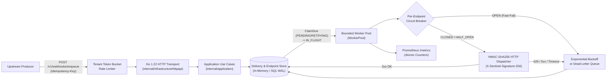

# Sentinel Relay (`relayd`)

**Multi-Tenant Transactional Outbox & Webhook Delivery Engine in Pure Go.**

Sentinel Relay ingests high-throughput upstream events, guarantees idempotent persistence per tenant, signs outbound payloads with HMAC-SHA256, and dispatches webhooks through bounded worker pools protected by per-endpoint circuit breakers and exponential backoff. Built entirely on the Go 1.22 standard library (`net/http`, `database/sql`, `context`, `log/slog`, `crypto/hmac`, `sync/atomic`) with zero third-party framework bloat.

## Why Sentinel Relay?

- **Zero Duplicate Deliveries on Upstream Retries:** Composite `(tenant_id, idempotency_key)` uniqueness returns the existing `Delivery` aggregate on duplicate ingestion without creating duplicate jobs.
- **Noisy-Neighbor & Outage Isolation:** Per-tenant token-bucket rate limiters protect ingestion, while per-endpoint circuit breakers (`CLOSED` -> `OPEN` -> `HALF_OPEN`) stop retry storms against failing downstream servers.
- **Deterministic Retry & Dead-Letter Replay:** Transient failures (`408`, `429`, `5xx`, network timeouts) reschedule with exponential backoff; terminal `4xx` errors fail fast to the Dead-Letter Queue (`DEAD_LETTERED`) with one-call operator replay (`POST /v1/dlq/{delivery_id}/replay`).
- **Strict Clean/DDD Boundaries:** `internal/domain` has zero external I/O imports. Transport handlers depend only on single-responsibility use-case interfaces.

## System Architecture



## Quickstart

```bash
# 1. Run the full test suite with the Go race detector
make test

# 2. Run static analysis
make lint

# 3. Run baseline memory & throughput benchmarks
make bench

# 4. Build and start the relayd server on :8080
make build && ./bin/relayd
```

### Verify End-to-End Dispatch with `curl`

```bash
# 1. Register a subscriber webhook endpoint
curl -s -X POST http://localhost:8080/v1/endpoints \
  -H "Content-Type: application/json" \
  -d '{
    "tenant_id": "tenant_acme",
    "endpoint_id": "ep_orders",
    "target_url": "https://example.com/webhooks/orders",
    "secret_key": "whsec_0123456789abcdef0123456789",
    "rate_limit_rps": 100,
    "max_concurrency": 8
  }'

# 2. Enqueue an idempotent webhook event
curl -s -X POST http://localhost:8080/v1/webhooks/enqueue \
  -H "Content-Type: application/json" \
  -H "Idempotency-Key: evt_ord_2026_001" \
  -d '{
    "tenant_id": "tenant_acme",
    "endpoint_id": "ep_orders",
    "event_type": "order.settled",
    "payload": {"order_id": "ord_2026_001", "amount_cents": 14900},
    "max_attempts": 5
  }'

# 3. Inspect Prometheus telemetry
curl -s http://localhost:8080/metrics
```

## Zero-to-Production Tutorial Suite

Follow the four engineering chapters in order to build, verify, and operate Sentinel Relay from first principles:

| Chapter | Architectural Focus | Key Packages Covered |
| :--- | :--- | :--- |
| **[01. Domain Modeling, OOD & SOLID](./docs/01-domain-and-solid.md)** | Bounded contexts, immutable Value Objects, Aggregate state machines, and consumer-segregated ports. | `internal/domain`, `GLOSSARY.md`, `docs/adr/ADR-001-architecture-blueprint.md` |
| **[02. Core Engine & Concurrency](./docs/02-core-engine-and-concurrency.md)** | Use-case orchestration, bounded worker channels, deterministic fake clocks, and per-endpoint circuit breaking. | `internal/application`, `internal/infrastructure/memory` |
| **[03. Persistence, HTTP API & Scaling](./docs/03-persistence-and-api.md)** | Atomic lease claiming (`ClaimDue`), composite idempotency keys, HMAC-SHA256 signing, and Go 1.22 routing. | `internal/infrastructure/sqlstore`, `internal/infrastructure/httpapi`, `internal/infrastructure/httpclient` |
| **[04. Production Ops & Benchmarks](./docs/04-production-ops-and-benchmarks.md)** | Token-bucket rate limiting, lock-free Prometheus metrics, graceful shutdown, Distroless Docker builds, and p99 benchmarks. | `internal/infrastructure/observability`, `cmd/relayd`, `Dockerfile`, `Makefile` |

## Navigation

[Hub](./README.md) | [ADR-001 Blueprint](./docs/adr/ADR-001-architecture-blueprint.md) | [Glossary](./GLOSSARY.md) | [Next: 01. Domain & SOLID →](./docs/01-domain-and-solid.md)
