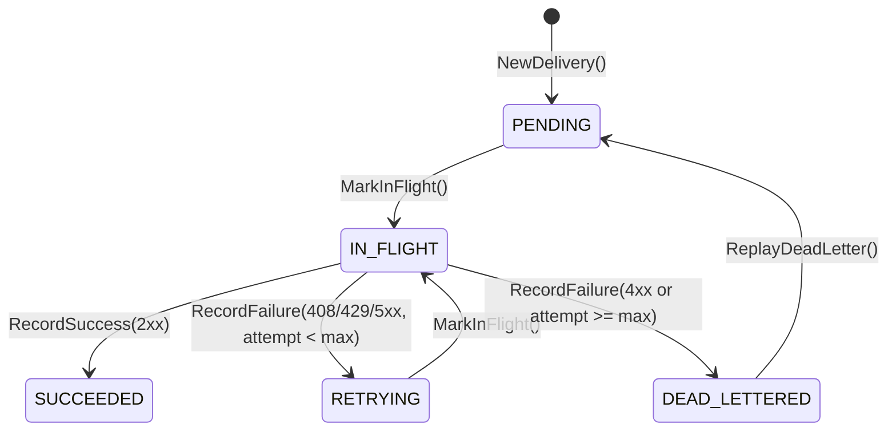

# Chapter 01: Domain Modeling, OOD Composition & SOLID Boundaries

[← Previous: Project Hub](../README.md) | [Hub](../README.md) | [Next: 02. Core Engine & Concurrency →](./02-core-engine-and-concurrency.md)

## Prerequisites

- Go 1.22+ installed (`go version`)
- Familiarity with basic Go structs, interfaces, and table-driven tests
- Review of [ADR-001](./adr/ADR-001-architecture-blueprint.md) and [`GLOSSARY.md`](../GLOSSARY.md)

## 1. Why Isolate the Domain Layer?

Webhook engines fail in production when HTTP status parsing, retry math, and SQL queries bleed into a single handler function. When retry rules live inside an HTTP handler or a SQL stored procedure, you cannot test edge cases (like `429 Too Many Requests` vs `400 Bad Request`, or circuit-breaker cooldowns) without booting a database and network stack.

In Sentinel Relay, `internal/domain` imports only standard library value packages (`crypto/hmac`, `crypto/sha256`, `encoding/hex`, `errors`, `fmt`, `math`, `net/url`, `strings`, `time`). It has zero knowledge of `database/sql` or `net/http`.

## 2. Value Objects: Enforce Invariants at Construction

Instead of passing raw `string` parameters across methods and repeating length/format checks, we wrap primitives in self-validating Value Objects (`internal/domain/value_objects.go`):

```go
type SecretKey string

func NewSecretKey(v string) (SecretKey, error) {
	if len(v) < 16 {
		return "", ErrWeakSecretKey
	}
	return SecretKey(v), nil
}

// SignPayload computes an HMAC-SHA256 signature formatted as "sha256=<hex>" over "<unix_timestamp>.<payload>".
func (s SecretKey) SignPayload(timestamp time.Time, payload []byte) string {
	mac := hmac.New(sha256.New, []byte(s))
	prefix := fmt.Sprintf("%d.", timestamp.Unix())
	mac.Write([]byte(prefix))
	mac.Write(payload)
	return "sha256=" + hex.EncodeToString(mac.Sum(nil))
}
```

Once a function accepts a `domain.SecretKey`, it is guaranteed to hold at least 16 bytes of entropy and knows how to sign and verify payloads in constant time (`hmac.Equal`).

Similarly, `BackoffPolicy` is an immutable Value Object that calculates exponential retry delays without mutating state:

```go
func (b BackoffPolicy) NextDelay(attempt int) time.Duration {
	if attempt <= 1 {
		return b.InitialInterval
	}
	factor := math.Pow(b.Multiplier, float64(attempt-1))
	delay := time.Duration(float64(b.InitialInterval) * factor)
	if delay > b.MaxInterval || delay <= 0 {
		return b.MaxInterval
	}
	return delay
}
```

## 3. Aggregate Root State Machine: `Delivery`

`Delivery` (`internal/domain/delivery.go`) owns its lifecycle state transitions:



Key invariants enforced directly on the aggregate:
1. **Valid State Transitions Only:** Calling `RecordSuccess` or `RecordFailure` on a delivery that is not `IN_FLIGHT` returns `ErrInvalidStateTransition`.
2. **Smart Retry Classification (`IsRetryableStatusCode`):** Network errors (`0`), `408 Request Timeout`, `429 Too Many Requests`, and `500–599` trigger `RETRYING` until `AttemptCount >= MaxAttempts`. Client errors like `400 Bad Request` or `404 Not Found` transition immediately to `DEAD_LETTERED` on the first failure instead of wasting worker capacity.
3. **Manual DLQ Replay:** Operators can call `ReplayDeadLetter(now)` ONLY when `Status == StatusDeadLettered`, resetting `AttemptCount = 0` and `Status = StatusPending`.

## 4. SOLID & Object-Oriented Design in Practice

- **Composition over Inheritance:** Go intentionally omits class inheritance. `Delivery` composes `BackoffPolicy` as a method parameter on `RecordFailure` and emits `DomainEvent` values (`DeliveryEnqueuedEvent`, `DeliveryDeadLetteredEvent`) into an internal slice drained via `PullEvents()`.
- **Interface Segregation Principle (ISP):** In `internal/domain/ports.go`, read and write concerns are split at the boundary:
  - `EndpointReader` (`GetEndpoint`) vs `EndpointWriter` (`UpsertEndpoint`)
  - `DeliveryCommandRepository` (`Save`, `ClaimDue`, `Update`) vs `DeliveryQueryRepository` (`GetByID`, `ListDeadLetters`)
  The background `WorkerPool` depends only on `EndpointReader` and `DeliveryCommandRepository`—it cannot accidentally invoke administrative query methods.
- **Dependency Inversion Principle (DIP):** `internal/domain/ports.go` defines the `WebhookDispatcher` and repository contracts. Both `internal/infrastructure/memory` and `internal/infrastructure/sqlstore` implement those contracts inward.

## 5. Verification Checkpoint

Run the domain and in-memory contract tests with the race detector enabled:

```bash
go test -v -race ./internal/domain/... ./internal/infrastructure/memory/...
```

Expected output:

```text
=== RUN   TestValueObjectsAndSignature
--- PASS: TestValueObjectsAndSignature (0.00s)
=== RUN   TestDeliveryStateMachine
--- PASS: TestDeliveryStateMachine (0.00s)
=== RUN   TestCircuitBreakerTransitions
--- PASS: TestCircuitBreakerTransitions (0.00s)
PASS
ok  	github.com/anti-gravity-bit/sentinel-relay/internal/domain
=== RUN   TestStoreConcurrentIdempotencyAndClaiming
--- PASS: TestStoreConcurrentIdempotencyAndClaiming (0.00s)
PASS
ok  	github.com/anti-gravity-bit/sentinel-relay/internal/infrastructure/memory
```

[← Previous: Project Hub](../README.md) | [Hub](../README.md) | [Next: 02. Core Engine & Concurrency →](./02-core-engine-and-concurrency.md)
